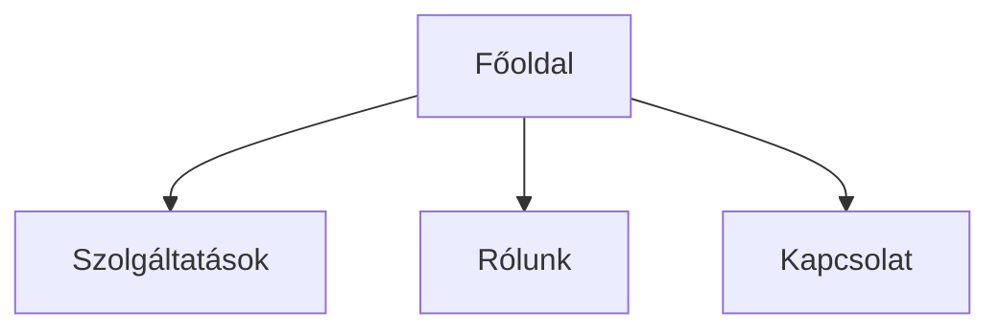

# UX-terv — {{BRAND_NEV}}

_Készült: {{DATUM}} | Skill: `ux-tervezo` v1_

---

## 1. Kontextus-összegzés

**Tevékenység:** {{TEVEKENYSEG}}
**Célcsoport:** {{CELCSOPORT}}
**Ajánlat:** {{AJANLAT}}
**USP / megkülönböztetés:** {{USP}}
**Brand-hang:** {{BRAND_HANG}}
**Konverziós cél:** {{KONVERZIOS_CEL}}
**Domináns tech-stack-irány:** {{STACK_IRANY}} (statikus / WordPress / hibrid)

---

## 2. Sitemap

### Mermaid flowchart

### Indented text + node-annotáció

- **Főoldal** — cél: {{}}; akció: {{}}
  - **Szolgáltatások** — cél: {{}}; akció: {{}}
  - **Rólunk** — cél: {{}}; akció: {{}}
  - **Kapcsolat** — cél: {{}}; akció: {{}}

---

## 3. Tartalomstruktúra (oldal × szakaszok)

### Főoldal
1. **Hero** — cél: {{}}
2. **{{SZAKASZ_NEV}}** — cél: {{}}
3. ...
X. **Footer**

### {{TOVABBI_OLDAL}}
1. ...

(Minden oldalra a szakasz-katalógusból válogatva, sorrendben, indoklással.)

---

## 4. Webszöveg-vázlatok

### Főoldal

#### Hero
**Címsor (H1) — A opció:** {{}}
**Címsor (H1) — B opció:** {{}}
**Alcím:** {{}}
**CTA gomb szövege:** {{}}
**Másodlagos CTA:** {{}}
**Vizuális utalás:** {{}} (csak utalás, nem design)

#### {{KOVETKEZO_SZAKASZ}}
{{}}

### {{TOVABBI_OLDAL}}

{{}}

---

## 5. Funkció-réteg javaslat

**Domináns tech-irány:** {{STACK_IRANY}}
**Indoklás:** {{INDOKLAS}}

### 🟢 Kötelező

| Funkció | Indoklás (brand-kontextusból) | Tech-implikáció | Szolgáltató-ajánlás |
|---|---|---|---|
| {{}} | {{}} | {{statikus/CMS/backend}} | {{}} |

### 🟡 Erősen ajánlott

| Funkció | Indoklás | Tech-implikáció | Szolgáltató-ajánlás |
|---|---|---|---|
| {{}} | {{}} | {{}} | {{}} |

### 🔵 Opcionális / későbbi fázis

| Funkció | Indoklás | Tech-implikáció | Szolgáltató-ajánlás |
|---|---|---|---|
| {{}} | {{}} | {{}} | {{}} |

---

## 6. Iterációs jegyzet

_A skill itt vezeti, hogy mit változtattunk a futások között. Későbbi köröknek kontextust ad._

- **{{DATUM}}:** {{VALTOZAS}}

---

## 7. AI-builder handoff jegyzet

A következő fázis (Claude Code / v0 / Lovable):
- Ez a dokumentum **mind specifikáció**. Másolható egészben vagy szakaszonként.
- A webszöveg-vázlatok (4. szekció) az AI-builder számára kész tartalom.
- A design (szín, font, képek, layout) **NEM része** — azt külön kell megadni az AI-builder-promptban.
- A funkció-réteg javaslat (5. szekció) megmondja, milyen 3rd party szolgáltatást kell bekötni.
