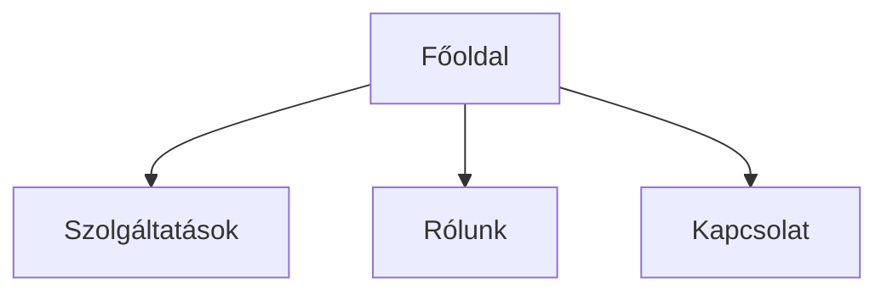

# IA + sitemap — információs architektúra és oldaltérkép

> A `ux-terv.md` 2. szekciójához. Hogyan rakod össze a sitemap-et: az IA három köre, oldalszám-stratégia, navigáció, mélység, hierarchia-szintek, URL-minták, formátum.

## Tartalom

1. Az IA „3 köre"
2. Sitemap-stratégia oldalszám szerint
3. Navigáció elvei
4. Mélység: flat vs. deep
5. 3-kattintásos szabály
6. Hierarchia-szintek (L0/L1/L2)
7. Oldaltípus-specifikus URL-minták
8. Sitemap-formátum

---

## 1. Az IA „3 köre" (Rosenfeld / Morville)

Minden weboldal-IA három tényező metszete:
- **Felhasználók** — a célcsoport-kutatásból
- **Tartalom** — a brand-anyag-intake-ből
- **Kontextus** — a célzott kérdezős fázisból

## 2. Sitemap-stratégia oldalszám szerint

| Oldalak | Stratégia |
|---|---|
| 1 oldal | Scroll-szakaszos landing |
| 3-5 oldal | Tipikus vállalkozói: Főoldal + Szolgáltatások + Rólunk + Kapcsolat + opc. Blog |
| 6+ oldal | Aloldalak szolgáltatásonként, esettanulmányok, GYIK külön |
| Webshop | Termék-kategória-fa + szűrők + kereső |

## 3. Navigáció elvei

- Top-nav: max 5-7 menüpont
- Mobil: hamburger menü kötelező
- Footer: másodlagos navigáció (jogi, kapcsolat, social)
- Breadcrumb: 3+ szintnél

## 4. Mélység: flat vs. deep

| Megközelítés | Mire jó | Tradeoff |
|---|---|---|
| **Flat (2 szint)** | Kis vállalkozói honlap, portfolio | Egyszerű, de nem skálázódik |
| **Közepes (3 szint)** | Tipikus vállalkozói / SaaS / tartalom | Jó egyensúly mélység és kereshetőség közt |
| **Mély (4+ szint)** | Webshop, nagy dokumentáció | Skálázódik, de eltemeti a tartalmat |

**Hüvelykujj-szabály:** menj amennyire flat lehet, amíg tiszta marad a navigáció. Ha egy top-nav-drop-down 20+ elemű, adj hozzá egy szintet.

## 5. 3-kattintásos szabály

A látogató bármelyik fontos oldalra **3 kattintással** elérjen a főoldalról. Nem abszolút, de ha kritikus oldal 4+ szint mélyen van, valami baj van a struktúrával.

## 6. Hierarchia-szintek (L0/L1/L2)

| Szint | Mi | Példa |
|---|---|---|
| L0 | Főoldal | `/` |
| L1 | Elsődleges szekciók | `/szolgaltatasok`, `/blog`, `/rolunk` |
| L2 | Aloldalak | `/szolgaltatasok/web-tervezes`, `/blog/cikk-slug` |
| L3+ | Mélyebb (webshop, dokumentáció) | `/kategoria/alkategoria/termek` |

## 7. Oldaltípus-specifikus URL-minták

| Oldaltípus | Tipikus mélység | URL-minta |
|---|---|---|
| Vállalkozói honlap | 1-2 szint | `/szolgaltatasok/<nev>`, `/rolunk` |
| SaaS marketing | 2-3 szint | `/funkciok/<nev>`, `/blog/<slug>` |
| Blog / tartalom | 2-3 szint | `/blog/<slug>`, `/kategoria/<slug>` |
| Webshop | 3-4 szint | `/kategoria/<alkat>/<termek>` |
| Dokumentáció / kurzus | 3-4 szint | `/kurzus/<nev>/<lecke>` |

## 8. Sitemap-formátum — mindkettő egyszerre



```
- Főoldal
  - Szolgáltatások
  - Rólunk
  - Kapcsolat
```

**Node-annotáció kötelező** minden oldalhoz: cél + elsődleges akció.
> `Főoldal` — cél: 5 mp alatt megértse mit kínálunk; akció: hero-CTA-kattintás (Ajánlatkérés).
